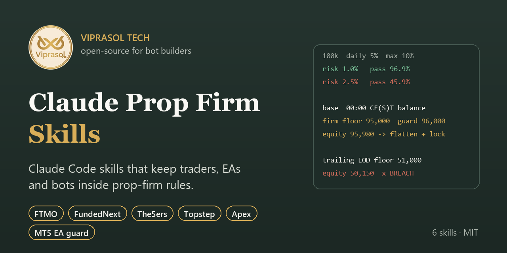

<div align="center">



### Claude Code skills for passing and keeping funded accounts

**Exact drawdown maths · challenge pass odds · MT5 equity guard EA · futures trailing-drawdown guards · news and banned-practice checks · rule-aware journals**<br>
FTMO · FundedNext · The5ers · FundingPips · Topstep · Apex, computed the way each firm computes them.

[](https://github.com/Viprasol-Tech/claude-prop-firm-skills/stargazers)
[](LICENSE)
[](https://code.claude.com/docs/en/skills)
[](#-whats-inside)
[](https://github.com/Viprasol-Tech/claude-prop-firm-skills/actions/workflows/ci.yml)

[Quick start](#-quick-start) · [What's inside](#-whats-inside) · [Examples](#-just-ask) · [Scripts](#-bundled-scripts) · [Changelog](CHANGELOG.md)

</div>

---

## 💬 Just ask

Install once, then talk to Claude Code normally. The right skill loads by itself.

```text
> My win rate is 48% at 1.8R. How much should I risk per trade on a 100k FTMO 2-Step?
> Add a daily-loss and max-loss guard to my MT5 EA for FundedNext.
> FTMO says I breached the daily loss but my closed P&L was only -3%. Why?
> Explain Topstep's trailing Maximum Loss Limit and code it into my bot's risk check.
> Check my EA against FTMO's news rule and the 2,000 requests a day limit.
> Here's my equity log - did I breach on any day, and how close did I get?
> Can I run my own fully automated EA on a FundingPips or Apex account?
```

## 📦 What's inside

| Skill | What it does |
| --- | --- |
| 📐 **`prop-rules-engine`** | Daily loss bases (balance vs. higher of balance and equity at the reset), reset times and time zones, static / end-of-day / balance / intraday **trailing** max loss and their locks, for six firms. Ships a **checker** that replays your equity log. |
| 🎲 **`challenge-planner`** | Monte Carlo **odds of passing** from win rate, R and risk per trade under the target, daily and max loss, minimum days and time limit. Ships a **simulator**. |
| 🛡️ **`mt5-ea-guard`** | A **PropGuard.mqh** template: equity guard with persisted day base, buffer, flatten-and-lock, open-risk check, request throttling, and firm days that follow EU/US daylight saving. Plus MT5 time and money pitfalls. |
| 📉 **`futures-bot-guard`** | Topstep and Apex trailing drawdowns, contract caps, session cut-offs, news contract limits, consistency, and which firms allow bots at all. |
| 🚫 **`restricted-practices`** | News windows by firm and account type, weekend holds, EA bans by size or platform, HFT and latency arbitrage, short-trade rules, cross-account hedging and copy trading. |
| 📒 **`prop-journal`** | What to log so your numbers match the firm's: day bases, equity lows, net P&L, best-day share, payout readiness. |

Rules are taken from each firm's own rules and help pages (checked November
2026) and linked from every skill's `reference.md`, together with what could
not be confirmed. Prop firms change rules often: the code takes rule models
as settings, never hard-coded firm names. This pack helps you comply with
rules; it does not help anyone get around them.

## ⚡ Quick start

**Option A: Claude Code plugin (recommended)**

```bash
claude plugin marketplace add Viprasol-Tech/claude-prop-firm-skills
claude plugin install prop-firm-guard@claude-prop-firm-skills
```

Skills are then available as `/prop-firm-guard:<skill>` and load
automatically when your request matches.

Want every Viprasol plugin? Add the [Viprasol marketplace](https://github.com/Viprasol-Tech/claude-plugins) once:
`claude plugin marketplace add Viprasol-Tech/claude-plugins`, then
`claude plugin install <plugin>@viprasol`.

**Option B: installer** (copies the skills to `~/.claude/skills`)

```bash
git clone https://github.com/Viprasol-Tech/claude-prop-firm-skills
cd claude-prop-firm-skills
bash install.sh                                        # macOS / Linux
powershell -ExecutionPolicy Bypass -File install.ps1   # Windows
```

No API keys, no accounts, no network calls. The scripts need only Python 3.10+.

## 🧰 Bundled scripts

**`challenge_sim.py`** - how risk per trade changes your odds:

```text
$ python challenge_sim.py --win-rate 0.45 --reward 2 --risk 1 --target 10 --daily-loss 5 --max-loss 10
expectancy           +0.35 R per trade
pass                 96.9%  (95% CI 96.7% - 97.2%)
fail: max loss       3.1%
$ python challenge_sim.py --win-rate 0.45 --reward 2 --risk 2.5 --target 10 --daily-loss 5 --max-loss 10
pass                 45.9%  (95% CI 45.2% - 46.6%)
```

Same edge, 2.5x the risk: the pass rate halves.

**`prop_rules.py`** - replay an equity log against a firm's rule model:

```text
$ python prop_rules.py equity.csv --initial 50000 --max 2000 --max-model trailing_eod --lock-at none --reset 17:00 --tz -06:00
BREACH  max loss at 2026-11-24T18:00:00-06:00: equity 50150 <= limit 51000
```

Never down $2,000 from the start, still breached: the trailing floor had
moved up with the end-of-day balance.

**`PropGuard.mqh`** - drop-in MQL5 guard for any EA (see `mt5-ea-guard`).

## 🗂️ Repository layout

```text
.claude-plugin/marketplace.json            marketplace manifest
plugins/prop-firm-guard/
  .claude-plugin/plugin.json               plugin manifest
  skills/<skill>/SKILL.md                  one folder per skill
  skills/<skill>/reference.md              firm sources and open questions
  skills/prop-rules-engine/scripts/prop_rules.py
  skills/challenge-planner/scripts/challenge_sim.py
  skills/mt5-ea-guard/templates/PropGuard.mqh
tests/validate_repo.py                     CI: manifests, frontmatter, links, scripts
```

## ⚠️ Disclaimer

This project is for **educational and engineering purposes only** and is **not
financial advice**. It is not affiliated with or endorsed by FTMO, FundedNext,
The5ers, FundingPips, Topstep, Apex Trader Funding, MetaQuotes, Anthropic or
any other firm mentioned. Firms change their rules and decide breaches by
their own systems: always read your account's current rules and confirm with
the firm. Test guards on a demo account; a guard reduces risk, it cannot
remove it. Simulated pass rates are not forecasts.

## 🤝 Contributing

Rule corrections with a link to the firm's page and the date you checked it
are the most valuable contribution. See [CONTRIBUTING.md](CONTRIBUTING.md)
and run `python tests/validate_repo.py` before opening a PR. More free Claude
Code packs from Viprasol:
[claude-trading-skills](https://github.com/Viprasol-Tech/claude-trading-skills) ·
[claude-options-trading-skills](https://github.com/Viprasol-Tech/claude-options-trading-skills) ·
[claude-tradingview-automation-skills](https://github.com/Viprasol-Tech/claude-tradingview-automation-skills) ·
[claude-crypto-bot-skills](https://github.com/Viprasol-Tech/claude-crypto-bot-skills) ·
[claude-fintech-skills](https://github.com/Viprasol-Tech/claude-fintech-skills) ·
[claude-india-stack-skills](https://github.com/Viprasol-Tech/claude-india-stack-skills) ·
[claude-voice-agent-skills](https://github.com/Viprasol-Tech/claude-voice-agent-skills) ·
[claude-video-editing-skills](https://github.com/Viprasol-Tech/claude-video-editing-skills).

## 📬 Contact — Viprasol Tech Private Limited

Need a prop-firm-safe Expert Advisor, a futures bot with proper risk
controls, or a dashboard for many funded accounts? That is what we build.

- 🌐 Website: [viprasol.com](https://viprasol.com)
- ✉️ Email: [support@viprasol.com](mailto:support@viprasol.com)
- 💬 Telegram: [t.me/viprasol_help](https://t.me/viprasol_help) · 📱 WhatsApp: +91 96336 52112
- 🐙 GitHub: [@Viprasol-Tech](https://github.com/Viprasol-Tech) · 💼 [LinkedIn](https://www.linkedin.com/in/viprasol/) · 𝕏 [@viprasol](https://twitter.com/viprasol)
- 📈 TradingView: [@viprasol](https://www.tradingview.com/u/viprasol/) · MQL5: [viprasol](https://www.mql5.com/en/users/viprasol)

## License

[MIT](LICENSE) © 2026 Viprasol Tech Private Limited
